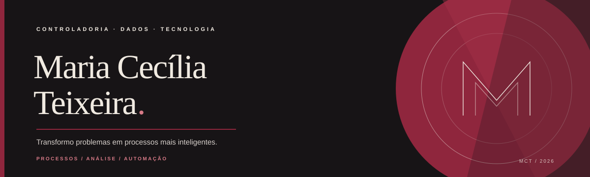
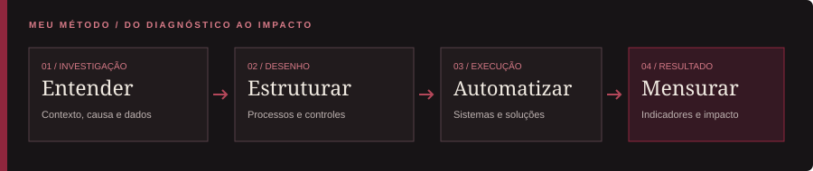

 

 

&nbsp;

 

NEGÓCIO × DADOS × SISTEMAS

### Eu gosto de resolver o que está no meio do caminho.

Do processo que ninguém mapeou à informação que ninguém consolidou, procuro entender a causa, organizar a lógica e construir uma solução que funcione na rotina.

---

## 01 &nbsp; / &nbsp; Sobre mim

Sou **Analista de Controladoria** e trabalho na interseção entre negócio, dados, processos e tecnologia.

Meu trabalho cruza Controladoria, análise de dados, melhoria de processos e desenvolvimento de soluções. Antes de automatizar, procuro entender a regra de negócio, a origem da informação e o que precisa melhorar de verdade.

**Meu método:** investigar a causa, desenhar o processo, construir a solução e acompanhar o resultado.

## 02 &nbsp; / &nbsp; Onde eu atuo

<table>
  <tr>
    <td width="33%" valign="top">
      
<strong>01 / CONTROLADORIA</strong>

      Planejamento orçamentário, análise de variações, indicadores, controles internos e apoio à tomada de decisão.
    </td>
    <td width="33%" valign="top">
      
<strong>02 / PROCESSOS</strong>

      Mapeamento, melhoria contínua, padronização de rotinas, eficiência operacional e automação de tarefas.
    </td>
    <td width="33%" valign="top">
      
<strong>03 / TECNOLOGIA</strong>

      BI, SQL, sistemas corporativos e aplicações web para resolver problemas concretos do negócio.
    </td>
  </tr>
</table>

## 03 &nbsp; / &nbsp; Ferramentas que uso

<strong>Dados & análise</strong>

<strong>Linguagens, frameworks & desenvolvimento</strong>

<strong>Bancos de dados</strong>

<strong>Sistemas & fluxo de trabalho</strong>

## 04 &nbsp; / &nbsp; Projeto público

<table>
  <tr>
    <td width="100%" valign="top">
      FULL-STACK APPLICATION &nbsp; / &nbsp; BUSINESS OPERATIONS
      <h3><a href="https://github.com/cicildss/custos-ecopower">Consulta de Produtos Protheus ↗</a></h3>
      Aplicação para consulta de produtos, saldo por armazém, cadastro e notas fiscais de entrada com fornecedor. O projeto conecta dados operacionais a uma experiência de consulta centralizada.
        
      
      
      
      
        
      <a href="https://github.com/cicildss/custos-ecopower">Explorar repositório</a>
    </td>
  </tr>
</table>

Outras soluções corporativas em desenvolvimento não são exibidas publicamente quando envolvem ambientes ou informações restritas.

## 05 &nbsp; / &nbsp; Atividade no GitHub

  
  &nbsp;
  

  

  

---

  

<a href="https://www.linkedin.com/in/mariaceciliateixeira123/">VAMOS CONVERSAR ↗</a>

  

Entender o negócio é parte do trabalho. Fazer a solução funcionar também.

